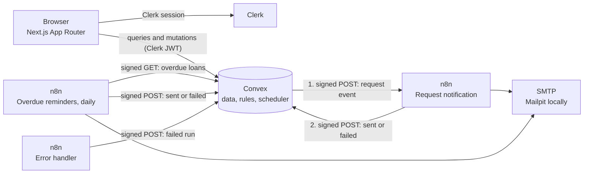

# LendLoop

A neighborhood tool-lending board. Neighbors list tools they are willing to lend, request to borrow
from each other, and get notifications and overdue reminders sent by n8n.

Stack: Next.js 16 (App Router), Clerk, Convex, n8n (self-hosted with Docker), TypeScript.

## Contents

- [Local setup](#local-setup)
- [Environment variables](#environment-variables)
- [Try it](#try-it)
- [Architecture](#architecture)
- [Automation with n8n](#automation-with-n8n)
- [Security decisions](#security-decisions)
- [Data minimization](#data-minimization)
- [UX decisions](#ux-decisions)
- [Tests](#tests)
- [Known limits](#known-limits)
- [Running this in production](docs/PRODUCTION.md)

## Local setup

You need Node.js 20.9 or newer, pnpm, Docker with Compose v2, and a free Clerk account.
Everything else runs on your machine: Convex as a local deployment, n8n and a fake mail inbox
(Mailpit) in Docker.

### 1. Install and start Convex

```bash
pnpm install
npx convex dev
```

When asked, choose to run Convex locally without an account. The command writes `.env.local`
(`CONVEX_DEPLOYMENT`, `NEXT_PUBLIC_CONVEX_URL`, `NEXT_PUBLIC_CONVEX_SITE_URL`) and keeps running.
Leave it open and use a second terminal for the next steps. The local backend listens on
`http://127.0.0.1:3210` (client) and `http://127.0.0.1:3211` (HTTP endpoints, the ones n8n calls).

If the Convex CLI is already logged in on your machine it will not ask. Start it with
`CONVEX_AGENT_MODE=anonymous npx convex dev` to get the same account-free local deployment.
A cloud deployment works too, but Convex then has to reach n8n over the internet: expose n8n
through a tunnel and use the deployment's `.convex.site` URL as `CONVEX_SITE_URL`.

### 2. Connect Clerk

1. Create an application in the Clerk dashboard with e-mail as a sign-in method. The app needs an
   e-mail address for every user, because that is where notifications go.
2. Activate the Convex integration for it at https://dashboard.clerk.com/apps/setup/convex and copy
   the Frontend API URL it shows, for example `https://your-app.clerk.accounts.dev`.
3. The integration adds only `"aud": "convex"` to the session token. LendLoop also needs the user's
   e-mail and first name, so open Configure, Sessions, Customize session token and add two claims:

   ```json
   {
     "email": "{{user.primary_email_address}}",
     "given_name": "{{user.first_name}}"
   }
   ```

   These are the only personal fields in the token, and the only ones the app reads.
4. Make first name required at sign-up (User & authentication, User model, Require first and last
   name), because LendLoop shows neighbors by first name only and falls back to "Neighbor" without one.
5. Add the API keys (Configure, API keys) to `.env.local`:

   ```bash
   NEXT_PUBLIC_CLERK_PUBLISHABLE_KEY=pk_test_...
   CLERK_SECRET_KEY=sk_test_...
   ```

6. Tell Convex which issuer to trust:

   ```bash
   npx convex env set CLERK_JWT_ISSUER_DOMAIN https://your-app.clerk.accounts.dev
   ```

### 3. Create the shared secrets

Convex and n8n sign their requests to each other with two different secrets, one per direction.
Each value lives in two places: the Convex deployment and the `.env` file that docker-compose reads.

```bash
TO_N8N=$(openssl rand -hex 32)
TO_CONVEX=$(openssl rand -hex 32)

npx convex env set CONVEX_TO_N8N_SECRET "$TO_N8N"
npx convex env set N8N_TO_CONVEX_SECRET "$TO_CONVEX"
npx convex env set N8N_REQUEST_WEBHOOK_URL http://localhost:5678/webhook/lendloop-request

cat > .env <<EOF
CONVEX_TO_N8N_SECRET=$TO_N8N
N8N_TO_CONVEX_SECRET=$TO_CONVEX
CONVEX_SITE_URL=http://host.docker.internal:3211
N8N_ENCRYPTION_KEY=$(openssl rand -hex 32)
EOF
```

`.env` and `.env.local` are gitignored. `.env.example` lists every variable with a comment.

### 4. Start n8n and Mailpit

```bash
docker compose up -d
```

A one-shot service imports the three workflows and the Mailpit SMTP credential from `n8n/` and
activates them, so there is nothing to click.

- n8n: http://localhost:5678 (it asks you to create a local owner account the first time you open it)
- Mailpit inbox: http://localhost:8025 (every e-mail the workflows send lands here)

### 5. Seed demo data and start the app

```bash
npx convex run seed:demo
pnpm dev
```

Open http://localhost:3000. The seed adds three demo neighbors (Ana, Ben, Cara), eight tools and
loans in every state, including one overdue loan for the reminder workflow.

### 6. Make yourself an admin (optional)

Sign in once so your user row exists, then:

```bash
npx convex run users:setRole '{"email":"you@example.com","role":"admin"}'
```

There is no way to become an admin from the app. See [Security decisions](#security-decisions).

## Environment variables

| Variable | Where | Purpose |
| --- | --- | --- |
| `CONVEX_DEPLOYMENT` | `.env.local` | Written by `npx convex dev`. |
| `NEXT_PUBLIC_CONVEX_URL` | `.env.local` | Convex client URL, written by `npx convex dev`. |
| `NEXT_PUBLIC_CONVEX_SITE_URL` | `.env.local` | Convex HTTP endpoints URL, written by `npx convex dev`. |
| `NEXT_PUBLIC_CLERK_PUBLISHABLE_KEY` | `.env.local` | Clerk publishable key. |
| `CLERK_SECRET_KEY` | `.env.local` | Clerk secret key, server only. |
| `CLERK_JWT_ISSUER_DOMAIN` | Convex env | Clerk Frontend API URL. Convex only accepts tokens from this issuer. |
| `N8N_REQUEST_WEBHOOK_URL` | Convex env | n8n webhook that receives request notifications. |
| `CONVEX_TO_N8N_SECRET` | Convex env and `.env` | Signs what Convex sends to n8n. |
| `N8N_TO_CONVEX_SECRET` | Convex env and `.env` | Signs what n8n sends to Convex. |
| `CONVEX_SITE_URL` | `.env` | Convex HTTP endpoints URL as the n8n container sees it. |
| `N8N_ENCRYPTION_KEY` | `.env` | Key n8n uses to encrypt its stored credentials. |
| `GENERIC_TIMEZONE` | `.env`, optional | Time zone of the daily 09:00 reminder run. Defaults to `Europe/Madrid`. |

"Convex env" means the deployment environment, set with `npx convex env set NAME value`.

## Try it

**Request notification.** Sign in, open Tools and request one of the demo tools. Mailpit shows
"New borrow request" addressed to the demo lender, and the request under My requests shows
"Cara was e-mailed just now" (with the lender's name). To play both sides (approve, decline, mark as returned), sign in with a
second account in another browser profile and request a tool you listed with the first one.

**Overdue reminder.** The workflow runs every day at 09:00. To run it now:

```bash
docker compose exec -e N8N_RUNNERS_BROKER_PORT=5680 n8n n8n execute --id=lendloopOverdue001
```

Mailpit shows the reminder for the seeded overdue loan, and the admin page shows "Reminder e-mailed
to Ben just now" in the Last e-mail column of that loan. Run the command again: no second e-mail, because Convex
skips loans that already have today's reminder. The extra variable only keeps the one-off command
from colliding with a port of the running instance.

**A failure.** Stop the mail server and change a request:

```bash
docker compose stop mailpit
# approve, decline or cancel a request in the app, wait about 90 seconds
docker compose start mailpit
```

The loan shows "E-mail to ... failed" in red, and the admin page lists the failed run under
Workflow errors.

## Architecture



### Where things live

```
convex/
  schema.ts            tables and indexes
  tools.ts loans.ts    user-facing functions (each one checks who is calling)
  admin.ts             admin-only functions (each one starts with requireAdmin)
  users.ts             user row from the Clerk identity, role changes (internal only)
  notifications.ts     Convex -> n8n hand-off with retries, result storage
  automation.ts        functions behind the n8n -> Convex endpoints
  http.ts              the signed HTTP endpoints
  lib/                 auth helpers, HMAC, dates, validators, shared views
src/app/               pages: / (public), /tools, /listings, /requests, /incoming, /admin
src/components/        UI
n8n/workflows/         the three exported workflows
scripts/               signed test tools for the n8n workflows
tests/                 vitest + convex-test
```

### Data model

- `users`: token identifier, first name, e-mail, role (`admin` or `user`), trusted lender flag.
- `tools`: owner, name, category, condition, description, status (`active` or `removed`).
  Deleting is a soft delete so loans keep their history.
- `loans`: tool, owner, borrower, start and end date, status
  (`pending`, `approved`, `declined`, `cancelled`, `returned`).
- `automationEvents`: one row per notification or reminder, with a unique idempotency key. This is
  what the app reads to show "Cara was e-mailed 3 minutes ago" or "Reminder e-mailed to Ben 2 days ago".
- `workflowErrors`: failed n8n runs reported by the error workflow, shown to admins.
- `auditLog`: admin actions (listing removed, trusted lender changed, role changed).

### Rules, enforced in Convex

Every function loads the caller from the verified Clerk token and checks the rule itself. The UI
hides buttons the server would refuse, it never decides.

- Anyone: `tools.listPublic`, which returns only the name and category of available tools.
- Signed-in users: create, edit and remove their own listings. Request a tool that is not theirs.
  Cancel their own pending request, or an approved loan that has not started (owner or borrower).
  Approve, decline or mark as returned only on their own tools.
- Admins: remove any listing, see all loans and users, set the Trusted Lender flag, see workflow errors.
- Loan rules: no past start date, at most 30 days, at most 90 days ahead, one pending request per
  borrower and tool, no approval that overlaps another approved loan, no approval of a request
  whose dates have already passed. An owner cannot remove a tool that has an approved loan not yet
  returned. Removing a tool declines its pending requests and notifies the borrowers.
- "Today" is the UTC date. Mutations read it from the server clock. Queries receive it as an
  argument, because Convex caches a query result until the data it read changes, and a cached
  query cannot notice that the day changed. The argument only moves display flags (available,
  overdue), never a rule.

## Automation with n8n

The workflows are in `n8n/workflows/` and are imported by `docker compose up -d`.

### 1. Request notification (Convex calls n8n)

Every status change of a loan (`request.created`, `request.approved`, `request.declined`,
`request.cancelled`, `loan.returned`, `loan.cancelled`) schedules a delivery in the same Convex mutation that changes
the loan, so the change and the notification commit together.

1. Convex posts the event to the n8n webhook, signed, with a stable event id (`<loanId>:<type>`).
2. n8n verifies the signature over the raw body, rejects anything invalid (401) or malformed (400),
   and drops event ids it has already seen (200, `duplicate: true`).
3. n8n answers 202, then sends the e-mail (three tries).
4. n8n reports the result (`sent` or `failed`) to Convex with a signed `POST /n8n/notifications`
   (five tries). Convex stores it on the loan, idempotently.
5. If the e-mail failed, the run also ends as failed, which triggers the error workflow.

Why the webhook answers before the e-mail is sent: the first version answered afterwards and Convex
treated a 2xx as "delivered". A test with the mail server stopped showed the flaw. Convex gave up
after 10 seconds and retried, n8n acknowledged the retry as a duplicate while the first attempt was
still failing, and the loan showed a notification that was never sent. Now the 2xx only means
"accepted", and the app shows what n8n actually reports.

### 2. Overdue reminders (n8n calls Convex)

Every day at 09:00 (and on demand) the workflow fetches overdue loans from a signed
`GET /n8n/overdue-loans`, sends one e-mail per borrower, and writes each result back with a signed
`POST /n8n/reminders`. The reminder key is `reminder:<loanId>:<date>`, so repeating the write-back
updates the same row. A reminder that failed is offered again on the next run, one that was sent is
not offered again that day.

### 3. Error handler

Both workflows use it as their error workflow. It posts the failed run (execution id, workflow,
node, a shortened message with e-mail addresses removed) to a signed `POST /n8n/workflow-errors`,
idempotent on the execution id. Admins see the list in the app.

### What happens when something fails

| Failure | Result |
| --- | --- |
| n8n is down, unreachable or answers 5xx | Convex retries the hand-off after 5 s, 30 s, 2 min and 10 min. After the fifth attempt the loan shows "Notification failed". |
| n8n rejects the event (4xx) | Stored as failed at once. Sending a rejected event again cannot help. |
| The same event arrives twice | n8n drops the second one by event id. One e-mail. |
| A notification e-mail fails | Three tries in the node, then the result is reported as failed, the run fails and the error workflow reports it. |
| A reminder e-mail fails | Three tries in the node, then stored as failed on the loan and tried again on the next run. The run itself continues with the other loans. |
| A call from n8n to Convex fails | The HTTP node tries five times, 5 s apart. Then the run fails and the error workflow fires. A reminder run stops at that loan on purpose: e-mails that cannot be recorded would be sent again by the next run. |
| A write-back is repeated | Convex updates the same row. A sent result is never downgraded to failed. |
| A request is forged, altered, replayed later or sent to another endpoint | 401, with no detail about why. |

Each row of this table is covered by a test, see [Tests](#tests). The error workflow reports to
Convex too, so while Convex itself is unreachable a failed run is visible only in n8n's execution list.

## Security decisions

**Authorization lives in Convex.** Next.js only checks that a session exists (the layout of the
signed-in area, `src/app/(app)/layout.tsx`).
Every Convex function identifies the caller from the token and applies the ownership or role rule,
so calling the API directly gets the same answer as the UI.

**No path to admin from the client.** `users.store` creates the user row and never touches the
role. Roles change only through an internal function that can be run from the Convex CLI or
dashboard, and the change is written to the audit log.

**Signed requests in both directions.** Headers `X-LendLoop-Timestamp` and `X-LendLoop-Signature`:

```
signature = "v1=" + hex(HMAC_SHA256(secret, "v1:" + timestamp + ":" + METHOD + ":" + path + ":" + rawBody))
```

- Two secrets, one per direction, so a leak on one side cannot forge messages for the other.
- Method and path are part of the signed text, so a valid signature cannot be replayed against
  another endpoint.
- The timestamp must be within 300 seconds, which limits replays.
- Both sides verify over the exact bytes received, never over re-serialized JSON.
- Comparison is constant-time (`crypto.subtle.verify` in Convex, `timingSafeEqual` in n8n).
- Convex fails closed: with no secret configured every request is rejected.
- Authentication failures always answer the same `401 Unauthorized`.

**Secrets.** They exist only in gitignored env files, the Convex deployment environment and the
n8n container environment. The exported workflows read them from the environment at run time and
contain none. The exported SMTP credential points at the local Mailpit and has no password.

**Idempotency.** Every write coming from n8n is an upsert on a unique key (event id, reminder key,
execution id). Retries update a row, they do not add one.

**Input validation at every edge.** Convex validators on all function arguments, explicit length
and date checks, manual validation of the JSON bodies n8n sends and a body size cap. Tool names and
first names are reduced to a single line when they are stored, since they end up in e-mail subjects
and greetings, and the notification workflow strips control characters again before building the message.

**Errors without personal data.** Stored error texts are short and fixed ("HTTP 503",
"Network error") or have e-mail addresses removed before they leave n8n. Convex never logs
payloads or exception texts.

**Auditable admin actions.** Removing someone's listing, changing Trusted Lender and changing a
role each write an audit row.

## Data minimization

- A user row holds a first name, an e-mail and the role. No last name, phone, address or avatar.
- The public page gets tool name and category only. Owners are not exposed, not even as ids.
- Signed-in views show first names, never e-mail addresses. Only admins see e-mails, in the user list.
- A notification payload carries what the message needs and nothing else: the event id and type,
  the recipient's first name and e-mail, the other person's first name, the tool name and the loan
  dates. A test pins the exact shape, so a new field has to be added on purpose.
- The overdue endpoint returns the borrower's first name and e-mail, the tool name and the dates.
- Error reports carry workflow, node and a cleaned message, not the data being processed.
- n8n keeps execution data for 14 days for debugging. Locally that is useful, in production it
  should be limited to failed runs (see `docs/PRODUCTION.md`).

## UX decisions

- **Borrowing is about dates, so dates are on the board.** Every tool shows its next 14 days as
  day pills (free, booked, your request, late) with one sentence under them ("Out, back Fri 20
  Nov"). Nobody has to ask blind and be declined.
- **A loan says what it is waiting on.** Cards read "Waiting for Cara", "Coming up", "Out now",
  "3 days late" instead of database states, and are grouped by what needs doing. Past loans are
  compact rows.
- **One decision stands out.** A request that needs your answer is the only solid colour card and
  Approve the only solid button on the screen. Red means late and nothing else, and colour is
  never the only signal: every state also has words.
- **No dead ends, no accidents.** Decline, cancel, mark returned and delete confirm inline. An
  approved loan can be cancelled by either side until it starts; after that only "mark returned"
  is offered, and the server enforces both.
- **Automation is visible but quiet.** Each loan shows its latest e-mail ("Reminder e-mailed to
  Ben 2 days ago"), with the history one click away. A failed delivery is red and stays visible.
- **Accessible by default.** Text contrast is at least 4.5:1, inputs have a visible edge, every
  action works from the keyboard with a visible focus ring and a skip link, focus moves into a
  form when it opens and back to its trigger when it closes, and status changes are announced.

## Tests

```bash
pnpm test        # 123 tests: authorization, loan state machine, HMAC, HTTP endpoints, notifications, loan stages
pnpm typecheck
pnpm lint
```

The n8n workflows have their own end-to-end script. It runs them against a small mock of the Convex
endpoints that verifies signatures and can fail on demand, something the real backend cannot do:

```bash
node scripts/mock-convex.mjs                                           # terminal 1
CONVEX_SITE_URL=http://host.docker.internal:3299 docker compose up -d  # point n8n at the mock
node scripts/test-n8n.mjs --smtp-down                                  # 14 checks, a few minutes
docker compose up -d                                                   # point n8n back at Convex
```

It checks valid, altered, expired, future-dated and unsigned requests, duplicates, all six event
types, a stopped mail server in both workflows, a write-back that fails once and one that keeps
failing.

While n8n points at the mock, `node scripts/send-test-event.mjs` posts a single signed event to the
webhook by hand (`--tamper` and `--age 400` show the rejections).

## Known limits

- n8n stores an event id before it sends the e-mail. If n8n crashes between accepting an event and
  reporting its result, nothing retries that event. The same goes for the step before: Convex runs
  a scheduled action at most once, so a backend that stops in the middle of a hand-off loses that
  event. Production would add an outbox and a reconciliation job.
- A notification e-mail that still fails after three tries is reported and visible, but not retried
  later. Reminders are, on the next run.
- Reminders are delivered at least once. If a reminder is sent and its write-back then fails every
  retry, or a manual run overlaps the scheduled one, the borrower can get it twice.
- The HMAC secrets reach the n8n Code nodes through the container environment, which requires
  allowing environment access in nodes. Those nodes can then read every variable of the container,
  the n8n encryption key included. Acceptable for a local single-user instance only.
- Dates are UTC. Lists are capped (50 to 1000 rows) instead of paginated.

What I would change for a real deployment is in [docs/PRODUCTION.md](docs/PRODUCTION.md).
